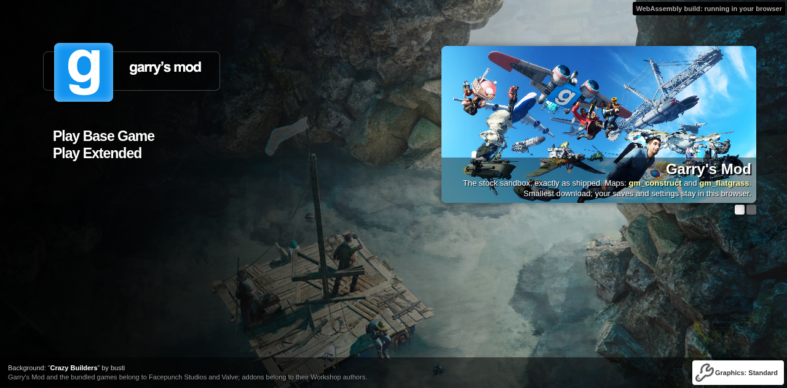
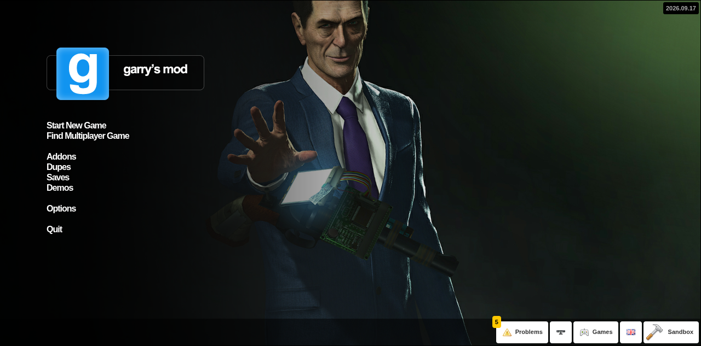
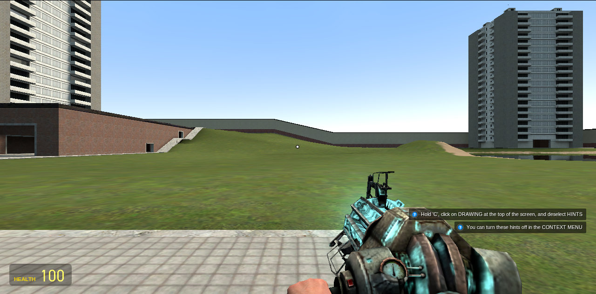

# garrys-wasm

Garry's Mod running in the browser. The retail game's 32-bit x86 DLLs are statically recompiled to
WebAssembly (`tools/lift/`) and run by a JavaScript host with a D3D9→WebGL renderer, virtual filesystem,
Steam/Winsock shims and an optional WebRTC multiplayer layer.

| Launcher | Main menu | In game (gm_construct) |
| --- | --- | --- |
|  |  |  |

## Layout

| Path | What it is |
| --- | --- |
| `tools/lift/` | x86 PE → Wasm recompiler (Python) and the Node runtime host (`host/`). See its README. |
| `runtime/`, `web/`, `ui/` | Browser host: launcher, workers, D3D9/GPU shims, input, storage, p2p |
| `ports/gmod/engine/` | Source engine fork (Emscripten/WebGL "ToGLES" work); see its `LICENSE` |
| `ports/gmod/compat/` | Compatibility layer, probes and tests |
| `tools/` | Packaging (`package-web.mjs`, `package-cdn.mjs`), benchmarks, browser tests |
| `docs/` | Performance notes and runtime plan |

## Setup

**This repo contains source only.** You need your own legitimate copy of Garry's Mod (Steam), and you
build the Wasm yourself. Nothing from the game is distributed here.

Requirements: Node 20+, Python 3.10+, a Chromium-based browser, and a Linux/macOS shell. The full
build is memory-hungry (peak ~2 GB per DLL) and the outputs are several GB.

```sh
npm install

# 1. Lift the game DLLs (once per game update)
cd tools/lift
python3 -m venv .venv && .venv/bin/pip install pefile capstone unicorn wasmtime keystone-engine lief
.venv/bin/python build_dll.py <GarrysMod>/bin/<dll> --base 0x00400000 --out out/<name>   # see tools/lift/README.md
.venv/bin/python difftest.py                                                              # sanity check the lifter
cd ../..

# 2. Serve it, pointing at your install
GMOD_ROOT="$HOME/.steam/steam/steamapps/common/GarrysMod" node web/server.mjs --port 8080
```

Open http://127.0.0.1:8080/ for the launcher. Useful URL parameters: `?edition=base` skips the launcher,
`?cmd=%2Bmap%20gm_construct` starts a map directly.

Tests: `npm test` (runtime), `node --test tests/*.test.mjs`, `npm run test:lift`.
Headless browser smoke test: `node tools/web-test.mjs --seconds 60 --out run/web`.
`package:web` builds a self-contained bundle (`npm run package:web`); user addons and saves are never included.

## Status and legal

Performance on low-end hardware is still being worked on (`docs/performance-n4000.md`).
Garry's Mod and Source are owned by Facepunch Studios and Valve; this project is unaffiliated. You must own
the game, and addons belong to their authors. The engine fork is derived from a public Source SDK repository
and keeps its original license.
